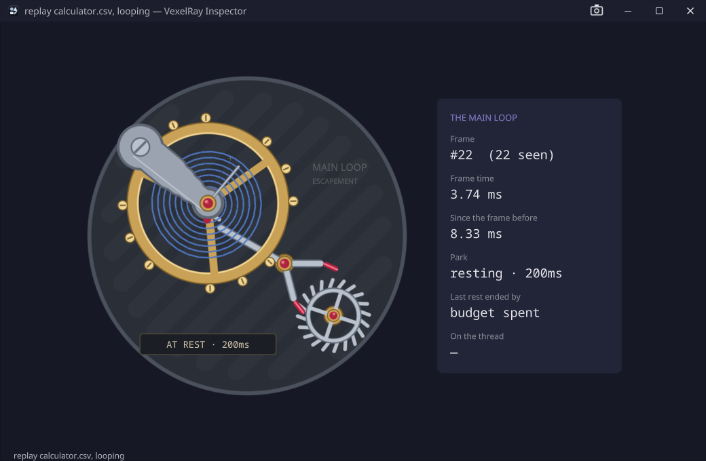

# VexelRay Inspector

DevTools for VexelRay applications, drawn as clockwork. Every working part of a running app (its frame loop,
messages, timers, animations, swapchain buffers, idle threads, GCs) is a mechanism on screen, and every mechanism maps
to a real subsystem. Built on [vexelray-gui](../vexelray-gui) through [vexelray-framework](../vexelray-framework),
from its `vexel-desktop` template, and a **framework witness** like Vexplore: the gaps it finds go upstream.

- **The plan**: [docs/roadmap.md](docs/roadmap.md) says what the Inspector is made of, what the stack has to grow
  for it, and the milestones. The data comes from the automation socket's flight recorder,
  `vexelray-gui/docs/plans/flight-recorder.md`.
- **What is not done**: [docs/TODO.md](docs/TODO.md).
- **What the framework did to us**: [docs/framework-notes.md](docs/framework-notes.md).



*The calculator demo's main loop, replayed from `samples/calculator.csv`: frame 22 took 3.74 ms, and the loop has
parked with a 200 ms budget, so the balance wheel rests and the plaque says so.*

## Status

**Milestone 1, first light.** It inspects a running VexelRay application live, through the application's Inspector
link, or it plays a recording.

| Works | Not yet |
| --- | --- |
| The **escapement**: the balance wheel swings one beat per `frame.present`, the fork snaps across and the escape wheel steps half a tooth | Frame stages in the swing (INPUT, CLOCK, APP, SETTLE): M2 |
| A **park is a rest**: the wheel stands still, and the plaque names the park's budget (`200ms`, `until woken`) | Saying a stall while it is still going on: the Inspector learns of one only when a row ends it |
| Readouts: frame number, frame time (its `frame` span), the time since the frame before, the park and how long the last rest lasted, and what ended it (`mutation`, `injected input`, the budget running out) on which thread, and how many rows the stream lost | The recorder's own cost |
| **Live**: the picker lists the running applications from their discovery files; choosing one, or `--attach=<app>`, streams its `frame` lane over its link; when it goes away the picker comes back | Attaching by launching: `--launch <command>` |
| **A gap is not made up**: rows the stream lost are counted, nothing is measured across them, and the first frame after says `MISSED BEATS` | |
| **A gap no park covers is a stall**: when the loop was silent more than 100 ms beyond the park's budget (`csvview --gaps`' rule), the plaque says `STALL · #7 · 1.50 s` in ruby and the readouts count them; a gap the stream lost is never one | |
| **Replay** of a probe CSV at its recorded pace, looping, faster or slower | Reading the other lanes (M2 on) |
| **History by build**: every live run of an application whose build is known is kept (frames, frame time p50/p95/p99, stalls, rows lost, parks), keyed by its exact source and its stack's, and the strip under the movement compares this build with the ones before | Saying, at a glance, that this build is worse than the last (M8's rules) |
| 38 tests, none of which needs a window; one builds the real tree headless, one streams from a real link | |

## Run it

```
mvn compile exec:exec "-Dapp.args=--replay=samples/calculator.csv"
```

`exec:exec` rather than `exec:java`, so native access can be enabled for Panama FFM. Without `--replay` the window
opens on the picker. The picker lists every VexelRay application running with its automation socket on, read from
the discovery files in `~/.vexelray/automation/`. Choose one, and the escapement follows it live.

```
mvn compile exec:exec "-Dapp.args=--attach=calculator-vexel-demo"         # straight to a running application
mvn compile exec:exec "-Dapp.args=--attach=pid:18292"                      # one process, when several share a name
mvn compile exec:exec "-Dapp.args=--replay=run.csv --replay.speed=0.25"   # a quarter of the recorded pace
mvn compile exec:exec "-Dapp.args=--replay=run.csv --replay.loop=false"   # once, then rest
mvn compile exec:exec -Dautomation=0                                       # a driving socket on a free port
mvn test
```

### Recording something to replay

Any VexelRay application writes the rows the Inspector reads when Probe is switched on as a correlation log
(`vexelray-gui/docs/reference/automation.md` §4):

```
mvn compile exec:exec "-Dapp.jvmArgs=-Dprobe=all -Dprobe.format=csv -Dprobe.out=run.csv"
```

`samples/calculator.csv` is one, from `calculator-vexel-demo` driven by `ottermate` (a few keystrokes with pauses, so
the loop both bursts and parks). It is trimmed to the 4.9 s after the window first showed, about 1,900 rows on every
lane; that its `seq` starts at 3297 rather than 1 is the trim, not loss.

## How it is put together

The flow is one line: **source → escapement → window**.

| File | What belongs in it |
| --- | --- |
| `Recipes.java` | **what this application builds**, one `@Provides` per part: the first source, the switch in front of it, the picker, the window, the escapement, and the start. `InspectorAppWiring` is generated from it. |
| `rows/` | **the rows, with no `Gui` in them.** `Row` is the `correlations.csv` schema plus the stream's `frame` column. `RowFormat` reads a line (RFC 4180 quoting, a header row naming the columns, torn lines skipped and counted). `RowSource` is the seam: `ReplaySource` plays a file at its recorded pace, and `LinkSource` streams a running application over its Inspector link (`LinkClient`, from `vexelray-gui-inspector-link`). `Sources` stands in front of whichever is current, and is the one place the source changes. `Attach` says which running applications `--attach` and the picker offer, from `Discovery.live()`. |
| `Picker.java` | the running applications to choose from, read from the discovery folder every second on the offload lane, while nothing is being inspected. |
| `clock/` | **the mechanisms as state.** `Escapement` reads the `frame` lane (`frame.present` ticks, `loop.park` rests, the `frame` span and the first `wake` after a park) into a `Beat`, one immutable value, and tells a listener. |
| `history/` | **every run kept, by build.** `Build` is what an application advertises in its discovery file: coordinates, its exact source (commit, plus `+dirty.<digest>` of uncommitted changes) and a digest of every stamped stack part, so two runs are one build only if all of it matches. `Session` measures a run from the escapement's beats; `History` keeps one CSV line per run in `~/.vexelray-inspector/history/<group>/<artifact>.csv` and sums runs per build; `Recorder` (behind `Runs`) begins and ends runs as sources switch. A replay, or an application built without `vexelray-build-maven-plugin`, is shown and not kept. |
| `Ui.java` | the window: the movement beside its readouts, the build strip under them, and a status line. The escapement's listener, so everything shown is derived from one `Beat`. |
| `Movement.java` | the escapement on screen, and its animation. |
| `Parts.java` | the parts, drawn: plate, balance wheel, pallet fork, escape wheel, balance cock. |

`Inspector.java` is the entry point and its constants. `Look.java` and `Landmarks.java` are the vocabularies: colour,
and the names an automation script may depend on (`movement`, `balance`, `plaque`, `readout.*`).

### How the clockwork is drawn

Each moving part is a `Picture` (`vexelray-gui-draw`), authored once and upright in a square box centred on its
pivot, and turned with `Node.rotate`, which is a visual transform: nothing reflows and nothing is measured. A beat is
a `KronoGui.ramp` that writes three angles per frame and nothing else, and the pictures are only rebuilt when their
boxes are resized. The plate is the movement node's `picture` and the balance cock its `overlay`, so the cock is
drawn over the wheel as it is in a watch. A marched SDF viewport (drawing.md §7) would have bought lighting and
depth, which this does not need yet, at the price of a technique dependency and a pipeline. The metals are fixed
colours rather than theme roles: a movement is gold, steel and ruby in any theme.

### Threads

Whichever source is current delivers on a thread of its own, and the escapement and the window's listener run there.

- **A replay** delivers on `inspector-replay`, a platform thread that spends nearly all its time parked.
- **A live source** connects on `inspector-link`, which ends once the stream is open. The rows then arrive on
  elektro-Q's receive thread for that connection: one thread, one call at a time, in the application's order, which
  is what `RowSink` asks for. The end of a run, when the application goes away, comes on that thread too.
- **The picker** reads the discovery folder on the offload lane, asked by a one-second timer on the timeline.
- **The history** is fed beats on the source's thread. It reads and writes its files on the offload lane, and it
  writes the run in progress on the closing thread when the Inspector closes, because the lanes stop then.

A prop written off the GUI thread is applied by the next drain. The swing is moved onto the timeline
(`KronoGui.onTimeline`), so the angles are only ever touched there. Nothing runs inside the frame loop.

## Automation

The Inspector can be driven and read from outside, by a script, a macro or an agent, through the framework's two loopback
sockets: **remote control** (the keys, clicks and reads a person has) and **diagnostics** (the flight recorder, the
log, the Inspector). Both are in every build, the release one too, and both start off.

- **Switched on by hand**: the plug in the title bar opens the switches, one per socket, each with a port (blank for
  a free one).
- **Switched on at launch**, for an agent that means to: `--automation=0` (both, on a free port),
  `--automation.control=<port>`, `--automation.diagnostics=<port>`, or `VEXELRAY_AUTOMATION=0` in the environment.
- **Not there at all**: `--automation.available=none` (or `control`, or `diagnostics`), or
  `VEXELRAY_AUTOMATION_AVAILABLE` in the environment. A socket that is not available cannot be switched on by
  anything, and with neither available the plug is gone.

Whatever turned it on, **the plug's lamps say what each socket is doing**, remote control's (red) left of the plug and
diagnostics' (blue) right:

| Lamp | Means |
| --- | --- |
| none | off, and nothing has connected to it this session |
| ring | open, and nothing has connected yet |
| filled ring | open, and something is connected now |
| ring with a grey dot | open; something was connected and has gone |
| grey dot | off, after something had connected to it this session |

The plug's tooltip and the switches' window say the same in words, with the port and how many are connected.

## Taking a screenshot

Screenshots are `ottermate`'s (`vexelray-gui/vexelray-gui-automation-cli`). The plaque is the thing to wait on:

```
await plaque AT REST · 200ms
shot docs/screenshots/resting.png
```

```
ottermate --script check.txt --launch mvn.cmd -q compile exec:exec -Dautomation=0 "-Dapp.args=--replay=samples/calculator.csv"
```

`settle` works too, and returns between beats (a swing is a 130 ms ramp, and the replay thread is not on the
timeline), but it does not say *which* beat; `await` on a landmark does.

## A native executable

```
mvn -Pnative-release package -DskipTests      # target/vexelray-inspector.exe        no console
mvn -Pnative package -DskipTests              # target/vexelray-inspector-debug.exe  a console: prints the automation port line
```

From a Visual Studio developer prompt with a GraalVM JDK as `JAVA_HOME`. Both carry the Inspector's own automation
sockets, off until asked for ([Automation](#automation)). Not yet built natively.

## Logging

Through `sibarum.probe.Log`, as `Log.of("vexelray-inspector.<area>")`. From a checkout the console shows info and
`target/logs/vexelray-inspector.log` has debug; under `ottermate` the file is at trace with a probe trace beside it.
`--log=debug` changes the level for one launch.
